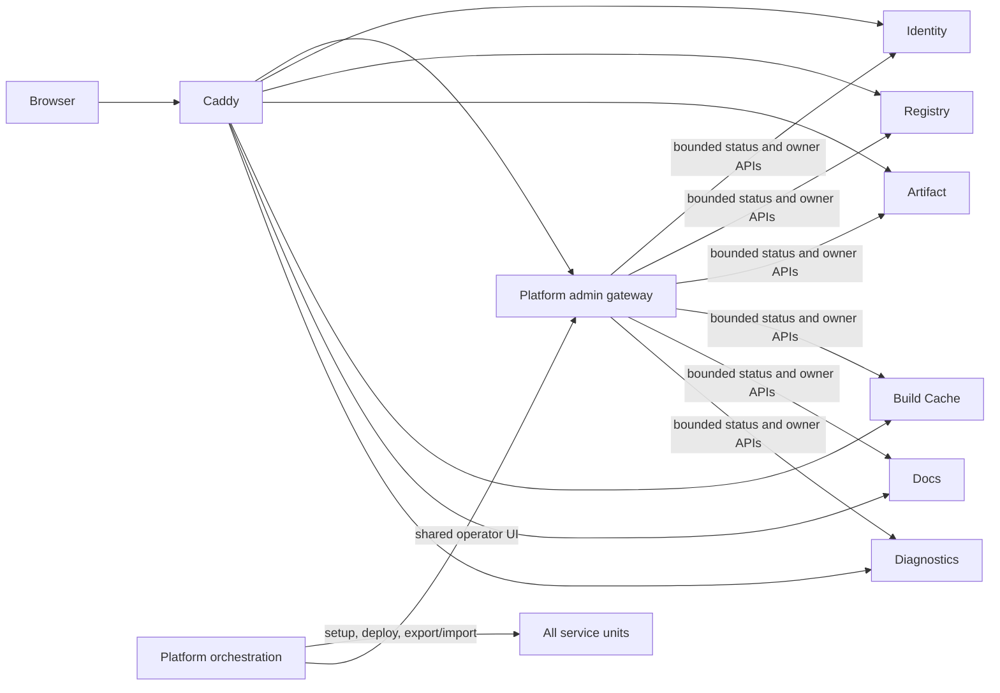

# Vapor Platform Operations and Recovery Redesign

**Status:** Owner-approved architecture; implementation in progress
**Date:** 2026-11-06
**Scope:** Vapor Platform Server and its service-owned admin, deployment, security, distribution, and recovery contracts. This document records the target architecture; it does not claim the current VPS already implements it.

## Intent

Make Vapor usable and operable as one coherent platform without turning it into
one giant service. Vapor's installer and updates are standalone and do not ship
through Steam; the current product decision keeps Steam as the required sign-in
provider, while Loo Cast remains optional. Operators should manage the platform through its web
dashboard as the normal human interface, while APIs and services enforce policy
and own their records. The same VPS must support independently rebuilt and
deployed services, one public domain, and a composed way to reconstruct or
recover the whole installation.

This is a pre-alpha architecture pass. Removing and replacing weak scaffolding
is allowed when the new ownership and migration path are explicit. Secrets,
licensed game files, and user-generated private diagnostics must never be swept
into ordinary source or public release artifacts.

## Baseline evidence (collected before current source changes)

The repository and live host were inspected on 2026-11-06. These facts describe
the deployed host and source at the start of this redesign. Subsequent local,
undeployed edits are called out separately.

- The deployed Platform source is detached at `6df33ec06ed1b604ce1ea49510f9b13ddd91162c`.
- The live host runs only `vapor-platform-server.service` and Caddy. The
  independent service units are not active. The deployed unit starts the
  Platform release binary, which currently composes Homepage, Docs, Identity,
  Diagnostics, Registry, Artifact, and Build Cache routers in `src/main.rs`.
- The independent Caddy template explicitly returns `503` for `/admin*`.
  Therefore the shared admin workbench does not currently survive the switch to
  independent service processes.
- At the start of this redesign, `export-state.sh` and `restore-state.sh` did
  not stop Registry despite copying its writable database. The current worktree
  now enumerates all eight service units for quiescing; this source change has
  not been deployed or runtime-verified.
- The local `/admin` shell assembles service HTML through middleware that
  searches for `main#admin-content` and buffers up to 8 MiB. This is fragile
  composition, not a stable UI extension contract.
- The public host returned `200` for `/`, `/admin`, Identity auth status,
  Registry status, Build Cache status, and Diagnostics status; `/docs/` returned
  `404`. HTTP success establishes route response only, not workflow readiness.
- Build Cache's public status reports both x86_64 targets as unconfigured and
  not current. The separate VPS-managed native/guest builder work is not ready.
- The VPS has 1 vCPU, about 1.8 GiB RAM, no swap, and about 46 GiB free on `/`.
  It is itself a KVM guest; `/dev/kvm` and the AMD virtualization flag are
  present, but QEMU/libvirt are not installed or active. Nested guest support
  is plausible, not proven. These resources are not evidence that concurrent
  Linux and Windows builds are viable; builder capacity is a real preflight
  gate, not just an unfinished service checkbox.
- The deployed state export archives `/var/lib/vapor-server` but excludes
  `/etc/vapor-server`, the OS, source checkout, systemd/Caddy definitions, Atlas
  web root, and credentials. The current worktree is changing this to schema v2
  with server configuration/credentials, selected host files, and exact source
  pins. This remains source-level work until deployed and restored on a
  disposable host.
- The hourly state-export timer was active. Recent bundles are about 4.8 MB;
  the backup directory is about 327 MB. Retention is count-based. This is useful
  state protection but has not demonstrated a clean-host rebuild-and-restore.
- Git working state contains user/VPS scratch files and untracked recovery
  artifacts. They are not part of this design and must be audited before any
  cleanup. No cleanup is authorized by this document.
- In particular, the untracked `deploy/scripts/recover-and-cutover.sh` has not
  been accepted as the recovery implementation. The independent read-only
  review found it forces monolith mode and treats a broad `/admin` status-code
  range as sufficient verification. Do not use it to claim the selected
  independent topology is restored.
- The previous temporary Codex and manual root keys have been removed from the
  VPS allowlist. The VPS still has a separately labeled owner root public key
  and the current work key. Its private half was not found in the current
  Windows OpenSSH `.ssh` directory, so control of that key remains unverified.
  Key rotation was backed up before editing.

These observations distinguish current implementation from the target below.

## Goals

1. Give operators one dependable, task-oriented web toolbench as their normal
   human interface. CLI/root operations remain for bootstrap and emergency
   recovery, not as the ordinary dashboard substitute.
2. Keep each service independently buildable, deployable, state-owning, and
   policy-owning, all on one VPS and behind one public origin.
3. Keep the shared dashboard as a real interface into owner-service APIs. It
   may aggregate presentation and send commands; it must not become a second
   record store or hidden authority.
4. Separate unanswered approvals from deployment execution, SSH grants, and
   history. A persisted decision and its subsequent operation are distinct
   stages in one understandable user action.
5. Support a composed setup, export, reinstall, and import path that can rebuild
   the VPS from pinned source plus service-owned state and host configuration.
   Keep a frequent VPS staging snapshot and automatically copy verified
   generations to the owner's unencrypted 128 GB USB drive when it is
   connected.
6. Keep normal break-glass access as an owner-controlled root SSH key that is
   independent of Vapor Identity. Do not invent a separate lockdown protocol or
   treat an ordinary USB flash drive as an HSM.
7. Allow a second low-cost VPS to become an optional worker and backup replica
   after its actual capacity and isolation are known. The main VPS remains the
   sole public and authority host; builds must still work locally when the
   worker is unavailable.
8. Make Vapor's public install/update path standalone. Local Loo Cast and Mad
   Max assets are acquired from their legitimate local sources and never
   distributed by Vapor servers.
7. Make product publication authority enforceable server-side; a client
   manifest or UI flag cannot make a restricted product publishable.
8. Replace prototype behavior with explicit ready, unavailable, pending,
   failed, and partial-source states. A service health response must never be
   mistaken for feature readiness.

## Non-goals

- A multi-node control plane or automatic service failover. One main VPS remains
  authoritative. A second VPS is an optional build/backup worker, not a public
  service host or a prerequisite for normal operations.
- Moving Registry, Identity, Artifact, or other service business rules into the
  Platform root.
- Making the dashboard the authority for roles, approvals, content policy, or
  audit. It is the primary human interface; owner services remain authoritative.
- Arbitrary shell, SQL, filesystem browsing, secret viewing, or general-purpose
  remote administration through the browser.
- Distributing Mad Max or Loo Cast proprietary content from Vapor Artifact,
  Registry, Build Cache, or public diagnostics.
- Treating Steam Workshop as Vapor's canonical catalog or Vapor's distribution
  channel.
- Claiming a complete audit history from bounded request endpoints or a single
  `latest.json` status pointer.
- Building MCP/ACP access in this pass.
- Cleaning scratch files or deleting historical backups until they have been
  individually classified.

## Approaches considered

1. **Independent services with per-service dashboards and links.** This keeps
   boundaries but leaves the operator to stitch workflows together and repeats
   today's navigation problem. Rejected because one dashboard is the intended
   day-to-day control surface.
2. **One central application owns all workflows and state.** It would simplify
   page composition, but duplicates service records/policy, risks bypassing
   owner audits, and makes independent deployment nominal. Rejected.
3. **Independent service processes behind one shared admin gateway (selected).**
   Platform owns shared navigation, page framing, health/attention aggregation,
   and explicit cross-service view adapters. Service APIs own decisions,
   validation, canonical state, and audit. The gateway presents the work and
   invokes the owning service. Platform composes whole-system setup and
   recovery. This is the selected target and matches the owner's answer.

## Recovery and worker choices

1. **VPS-local exports only.** Easy to operate, but does not survive loss or
   compromise of the primary host. Rejected as the final recovery path.
2. **Second-VPS copy only.** Adds off-host capacity but keeps both copies under
   remote-host/provider control and can accidentally become an availability
   dependency. Retained only as an optional extra replica.
3. **Hourly primary snapshots plus owner USB copy (selected), with an optional
   second-node replica.** The primary creates consistent snapshots; a local
   scheduled task pulls and verifies generations onto the unencrypted USB when
   available. Missed copies remain on the primary for catch-up. A future worker
   can improve build throughput and backup freshness without becoming a
   prerequisite for the platform.

## Invariants and ownership

| Concern | Owner | Platform/dashboard role |
| --- | --- | --- |
| User identity, roles, sessions, authorization, identity audit | Identity | Show and submit Identity workflows; never mint/copy roles |
| Catalog identity, source bindings, visibility, publishability rules | Registry | Present catalog tools; do not decide eligibility from client metadata |
| Immutable Vapor application releases and signed update feeds | Artifact | Show release state; no game payloads |
| Compiler snapshots, target candidates, promotion | Build Cache | Show target state and builder results; no Artifact conflation |
| Docs bundles and docs state | Docs | Link/render Docs workbench and readiness |
| Explicit diagnostics submissions, access, retention | Diagnostics | Present opt-in support workflow; no telemetry expansion |
| Deployment requests and deployment orchestration | Platform | Own fixed deploy lifecycle, worker status, and approval record |
| Temporary SSH request and grant lifecycle | Platform | Present requests/grants and submit reviewed choices; fixed root helper executes |
| Caddy, systemd, host setup, composed export/import/recovery | Platform | Own named, audited operations; no arbitrary browser shell |
| Shared admin gateway/frame and platform overview | Platform | Primary UI, aggregating only explicit owner APIs |
| Vapor client install, update, local source detection, local mounts | Vapor Client | Not part of VPS admin authority |
| Local Loo Cast / Mad Max content availability | Local product adapters + server policy | No local proprietary content upload or distribution |

The dashboard itself is the intended graphical interface. Saying that an owner
service is authoritative describes who validates and stores a change; it does
not mean the operator must bypass the dashboard and call an API manually.

## Admin workbench

The common shell is a real server-rendered shared gateway over the one public
origin. Service presentation and data remain modular, but no page depends on
post-load HTML surgery or a hard-coded list pretending unavailable modules are
ready.

### Deployment target is part of the approval

Every deployment request must pin both its source revision and the intended
runtime topology (`services` or, only while migration remains supported,
`monolith`). CI submits the target explicitly; the approval card displays it;
and the root worker executes exactly that target from the immutable request.
The worker must not infer the approved topology from mutable `/etc` state.
Requests created before this field exists are ambiguous and must not deploy:
they remain visible as legacy requests, can be rejected, and require a fresh CI
request before deployment. This keeps the approved action legible and prevents
a source-only approval from unexpectedly retaining or changing the live mode.

### Navigation and tasks

- **Overview:** platform/service health, separate feature readiness, current
  operation, pending approvals, and the next actionable operator task.
- **Approvals:** one first-class inbox for unanswered Platform deploy, Platform
  SSH, and Identity permission requests. Each item identifies its owner, exact
  subject/target, requester provenance, requested effect, actual selected
  policy, expiry, and review action. Decision writes go directly to the owner
  API. Per-source failure is shown without hiding other sources.
- **Deployments:** requests and their immutable revisions, CI/submodule evidence,
  approval decision, dispatch stage, execution progress, outcome, and retry or
  reconciliation eligibility. Current deployment and history are separate
  views.
- **SSH access:** pending requests, active grants, selected capabilities and
  duration, fingerprint, expiry, revoke/reconfigure actions, and grant events.
  Private key material is never rendered. Full `host_admin` is a distinct,
  explicit escalation.
- **Identity:** people/providers, roles, permission requests, credentials,
  sessions, and Identity audit, subdivided into clear tasks rather than one
  undifferentiated long page.
- **Hosting:** services, route checks, dependencies, configured versus ready
  features, timers/workers, and safe runbook links.
- **Distribution:** separate Registry/catalog, Artifact/releases, Build
  Cache/targets and builders workbenches. Each is labeled with its owner and
  readiness.
- **Support:** Docs and Diagnostics workbenches with their own state and
  policy.
- **History:** read-only owner-sourced views of completed/rejected/expired
  requests and operations. Incomplete owner history is labeled as bounded; it
  is never implied to be a universal ledger.
- **Recovery:** whole-platform setup status, source/config revision, per-service
  state export/import, backup inventory, restore preview, rebuild steps,
  validation, and last successful recovery drill.

Use grouped/collapsible navigation and concise lists with detail panels. The
initial view prioritizes what is pending and what needs action; lower-frequency
metadata and explanation remain available when an operator expands the item.
Every list has useful search/filtering where size warrants it, plus loading,
empty, unauthorized, unavailable, and partial-source states. Keyboard use and
small screens are first-class.

The first usable gateway release prioritizes **Approvals, Deployments, SSH
Access, Overview, Hosting, and Identity**, because these are the failing or
tedious operator journeys and already have owner-side request APIs. Registry,
Artifact, Build Cache, Docs, and Diagnostics may initially be inspection-only
where their current admin APIs are read-only; every incomplete write workflow
is explicitly marked unavailable. Recovery first presents an accurate
inventory and guided preflight; it does not expose restore buttons until the
composed operation has been rehearsed.

### Request and operation lifecycle

The one-click action remains one click where already selected, but its result is
explicitly staged. For deploy approval, the dashboard can report: review
accepted; owner decision durably saved; dispatch accepted/failed/unknown; worker
claimed/running; operation succeeded/failed/reconciled. A `503` after decision
save must not make the UI claim that the decision was not saved. Refresh shows
the durable owner state and permits only valid retries.

Approval is a cross-owner inbox view, not a cross-owner database or new
approval service. Platform and Identity retain their own records, validation,
transition rules, and audit events. The gateway records no duplicate request
status. A source outage is visibly local to that source.

History is likewise a presentation query. Existing 200-item owner limits and
latest-operation pointers must be disclosed until owner APIs provide durable
pagination/history.

### Shared gateway contract

- Caddy routes `/admin/*` to the shared gateway and owner service web/API paths
  to the corresponding independent processes under the same origin.
- The gateway composes the frame from a stable module descriptor/contract and
  typed, bounded view data. It must not parse and rewrite arbitrary service
  HTML. If a service renders its own page, it does so within an explicit shared
  layout contract, not by an HTML marker plus whole-body buffering.
- The first HTML-fragment contract is
  `application/vnd.vapor.admin-page.v1+html; charset=utf-8`: the owner returns
  only the contents of the page's `<main>` region, while Platform supplies the
  document, navigation, heading/status frame, CSS, and JavaScript. Platform
  accepts this media type only for a known implemented module path, applies the
  8 MiB bound, preserves the owner's status, and forces `private, no-store`.
  The owner remains responsible for authentication, authorization, auditing,
  and safe HTML encoding. Full HTML documents are passed through unchanged;
  they are never searched or rewritten by the shared shell.
- For independently deployed services, deploy the Platform contract consumer
  before an owner begins returning v1 fragments. Roll back in reverse order.
- Browser session/authentication is shared-origin and protected against CSRF;
  owner services re-check authorization on every mutation. A hidden/disabled
  button is not security.
- Each mutation is audited by the service owning the state, with actor,
  capability, exact target, outcome, timestamp, and operation/correlation ID.
- The dashboard uses progressive enhancement: navigation and basic reading
  work without JavaScript; script enhances search, polling, and interaction.
- Each module is either useful or explicitly unavailable with its actual
  blocker. A healthy process is not proof a module is configured.
- Browser forms use the shared-origin Identity session; Caddy forwards the
  request/session to the owner API, which rechecks the action and writes its
  audit event. Server-to-server scoped credentials are for bounded gateway
  summaries/health only, not a replacement actor for an operator mutation.

## Public Vapor and local product lifecycle

Vapor Client owns standalone install, update, repair, uninstall, managed tools,
source cache, and local mounts in the user-owned Vapor home. The Loo Cast Steam
application is a local content source, not the Vapor install root. Its intended
depot artifact contains exactly the Spacetime Engine, Loo Cast Game, and Loo
Cast Packagepack, plus `App.vapor.toml` and a tiny locator/forwarder that finds
the independent Vapor installation for the optional tools-selector launch
entry. The locator must never carry the Vapor runtime itself.

The Vapor installer presents only two local setup choices: **Player** and
**Developer**. Developer setup includes the complete managed developer toolset
by default and cannot silently omit required tools. Server-side ecosystem
developer authorization is a separate Identity decision; a local Developer
install or checked-out first-party repository does not grant server roles.

Mad Max is a separate externally acquired local engine source. MadMax.exe and
its owned files form the engine source; MadMaxModding is the packagepack that
installs the bridge/loader, and mod scripts/content compose the game layer.
Vapor may inspect or derive local caches from installed game files, but does
not upload or distribute proprietary bytes.

Vapor releases, source/product metadata, and local content are different
things. The source manifest can describe what was found; it cannot grant
publish rights. Registry owns server-side product/publishability policy.
Identity supplies verified author/developer permissions. Artifact serves
Vapor releases, not games or mod uploads. A distinct upload/publish pipeline is
needed for community content. Local-source-only and depot-provided product
records for the three Loo Cast items must be non-publishable by server policy,
even if a submitted manifest claims otherwise.

The exact Steam package/depot identities and how Loo Cast ownership or
Mad Max local presence proves product eligibility are not inferred from the
current `App.vapor.toml`; verify them against release metadata before changing
the Steam layout. The known manifest is historical evidence, not current
release truth.

## VPS deployment and composed recovery

### Normal runtime

One VPS runs separate systemd processes for Platform, Homepage, Docs, Identity,
Diagnostics, Registry, Artifact, and Build Cache. Caddy is the only public
entrypoint. It routes public paths and service-owned APIs directly to the
right process and routes the shared `/admin` shell to Platform. Platform makes
bounded authenticated service calls for dashboard summaries and owner
workflows. One service can be rebuilt/restarted without compiling or replacing
all the others. Platform deployment has its own pinned repository/submodule
plan; service deployments name an exact immutable commit/artifact.

The current composed-process mode may remain only as a local development or
test harness if it can honor the same contracts. It is not a production
topology; there is no permanent monolith fallback. No supported production
mode may replace `/admin` with a placeholder `503`.

Linux and Windows target builds use the pinned toolchain lock and exact target
triples. A second VPS may run the isolated build jobs and hold a verified copy
of recovery generations, but it is optional and does not host public routes or
own service state. Build Cache remains the authority for promoted snapshots.
Platform may dispatch work to the worker when it is reachable; when it is not,
the documented local build path remains available, though slower. A missing
worker can make a shared rolling snapshot stale; it must not make source builds
or service deployment impossible. The local machine is a fallback, not the
official long-term publisher of cache snapshots unless the existing Build
Cache publication contract explicitly validates the same candidate contract.

The current main host has 1 vCPU and about 1.8 GiB RAM, with no demonstrated
capacity for concurrent target builders. Do not install hypervisor packages or
claim worker readiness on it. The second-host role is decided only after its
actual Strato product, CPU/RAM/disk, operating system, network, and virtualization
capabilities are known. Keep the worker replaceable and disposable; its
reproducible inputs come from pinned source/toolchain contracts, not unique
state. A worker outage should result in local build fallback and a visible
stale-cache status, not a platform outage.

The clean-host target is the existing Ubuntu 26.04 baseline. Setup assumes
outbound access to the approved source/artifact endpoints and one operator with
root/bootstrap access to supply protected configuration or recover its
encryption key. It does not assume a prebuilt VPS image or a running Vapor
service. Offline bootstrap is not a first-release requirement.

### Setup, export, reinstall, and import

Platform provides named operations for:

1. **Setup/rebuild host:** validate the complete recovery bundle and confirm
   its Ubuntu release, architecture, and Rust host match the fresh host before
   installing or changing packages; then install OS packages/users/permissions,
   fetch exact approved source pins and submodules, install per-service units
   and Caddy routes, provision paths from protected configuration, start
   services in dependency order, then run local and public route checks.
2. **Export:** take coordinated service-owned state exports plus a composed
   manifest that records source revision, submodule pins, service schemas,
   host version, config references, and validation. Build caches and generated
   outputs are marked rebuildable and are opt-in; immutable release blobs are
   handled by Artifact's export contract.
3. **Reinstall/restore:** rebuild software from source and signed artifacts,
   restore each service's validated state using its own import operation, then
   run cross-service checks and write a durable recovery result.
4. **Rollback:** preserve the pre-operation source/config/state pointer and
   provide a tested recovery path for each named operation. Do not present a
   state-only tarball as a complete backup.

The owner-held 128 GB USB drive is the primary off-host recovery copy. Its
contents are intentionally unencrypted by owner choice. The VPS creates
consistent, hourly snapshots in a root-only staging directory; a Windows
scheduled task pulls each new completed generation over SSH when the USB is
mounted. Each copy is checksum-verified before it is considered present. The
VPS retains enough generations to backfill missed pulls when the desktop or USB
is offline. Once a second VPS exists, it may hold an additional verified
replica, but the USB remains the owner-controlled recovery set and the second
node is not a new authority.

The recovery bundle includes service data, `/etc/vapor-server` configuration
and credentials, the active Caddy configuration, the current Platform and
service/submodule revisions, and a manifest of the Ubuntu baseline and
rebuildable inputs. Compiler outputs and target snapshots are rebuildable and
are excluded from the default recovery bundle; immutable published release
assets remain included if the Artifact service cannot reproduce them from its
own source. The manifest names each included category, explicitly states that
the archive is unencrypted and contains credentials, and records hashes and
source pins without printing secret values. The USB retention policy is based
on verified archive size and available capacity, not a fixed number of files.
The dashboard and logs show last successful export/copy, checksums, sizes, and
staleness, never secret values. Loss or theft of the USB exposes its contents.

The local master recovery authority can rebuild, replace, and override Vapor
Platform-controlled state, including recovering the owner/admin path if the
Identity database or VPS configuration is damaged. It is not a universal key
that bypasses Steam or GitHub. Operations against those providers still use
their own authorized account credentials, app keys, or recovery flows; those
provider credentials may be carried in the owner's physical recovery set, but
Vapor cannot defeat a provider's revocation or access rules.

The break-glass path is the owner's ordinary OpenSSH root key, independent of
the Vapor Identity database and held separately from the USB archive. It lets
the owner repair or replace the host and run the recovery operation. Strato's
account and reinstall controls remain the out-of-band boundary if the VPS or
root access is lost; Steam and GitHub still enforce their own account recovery.
No custom HSM, time-limited lockdown mode, or per-command emergency PIN is in
scope. A USB flash drive is backup storage, not a hardware security module.

The recovery set records exact server/source/submodule revisions, service
schema versions, supported OS assumptions, config and credential inventory,
state export checksums, and which outputs can be rebuilt. Source is reconstructed
from the recorded GitHub revisions; the USB stores the sensitive configuration
and service state that Git cannot provide. Rebuildable target snapshots/caches
are optional; they are identified as such rather than silently required. The
owner can provision a fresh Strato VPS, bootstrap the declared OS baseline,
and restore the platform without relying on the old server.

“Working platform restored” requires every configured provider integration to
pass its defined readiness check, including Steam identity and GitHub/OAuth or
repository access where configured. If a provider has revoked or invalidated
its credential, the recovery operation remains incomplete until the owner
reauthorizes it through that provider. The local recovery authority cannot mark
that provider healthy by overriding its decision.

The initial cadence is hourly: Platform creates a consistent recovery export,
and the Windows-side scheduled sync pulls all unseen generations to the mounted
128 GB USB drive over the owner's existing SSH key. If the drive or desktop is
offline, the primary VPS retains generations for later catch-up; the dashboard
shows the USB copy as stale until a verified pull succeeds. A second VPS may be
configured as an additional replica after its specifications are known. It
does not replace USB recovery or alter the main host's authority.

Each service owns its state export/import schema. Platform coordinates,
orders, and validates them. Cross-service consistency is expressed as an
operation manifest and checkpoints, not by copying databases into Platform.
An interrupted export/restore identifies each service stage and whether it is
safe to retry. Recovery should be verified with a clean setup/export/nuke or
reinstall/import exercise on a disposable environment before it is advertised
as full-platform recovery.

The first recovery implementation must enumerate every state owner actually
running in the selected topology. In particular, Registry must be quiesced or
use a database-consistent online snapshot during both export and restore. A
whole-state directory copy is not safe merely because all services share one
parent directory.

For the pre-alpha recovery contract, use the current hourly state-export cadence
as the initial service-state recovery-point target (no more than one hour of
state loss for services whose writes are covered by that export). Make no
recovery-time promise until the clean-host drill measures setup, restore, and
validation. This is a proposed initial objective, not a claim that the current
backup achieves it: the schema-v2 source changes have not been deployed or
validated as an independent-service snapshot, and no clean-host restore drill
has passed.

### Independent operation and authorization

- Platform approval binds to exact root and submodule revisions before queueing.
- Identity role/access decisions remain Identity-owned.
- SSH request decisions and grant/revoke operations remain Platform-owned and
  use fixed typed root helpers.
- Each module has independent build, validation, approval/deploy, health check,
  rollback, and result.
- Composed setup/recovery is itself a named Platform operation with stages and
  a stable operation record. It does not silently call an unbounded shell from
  a web request.

## Delivery phases

1. **Baseline and contract cleanup:** preserve current changes; record exact
   repo/submodule/VPS baseline; classify user scratch files; fix truth gaps such
   as `/docs/` routing; define service readiness, admin-module, operation-stage,
   and recovery manifests.
2. **Operator workbench:** replace the HTML surgery shell; first make Overview,
   Approvals, Deployments, SSH Access, Identity, and Hosting genuinely usable;
   then bring Distribution, Support, History, and Recovery into the same
   contract. Keep source-specific errors and owner mutations. First correct
   current approval-stage persistence/503 confusion.
3. **Independent service cutover:** make `/admin` available in independent mode;
   route one origin through Caddy; define systemd/deployment per service;
   remove the 503 branch. Test one service's rebuild/restart without others.
4. **Authority and distribution:** add server-owned source/product and
   publishability policy; align Identity/Registry/Artifact/publish pipeline;
   reconcile actual Loo Cast Steam metadata and the Mad Max external-source
   boundary. No copyrighted data enters the Vapor feeds.
5. **Composed recovery:** make service-owned exports/imports complete; separate
   state, config/secrets, source/artifacts, and rebuildable caches; add a
   composed setup/reinstall/import workflow and verify it on disposable host
   state.
6. **Optional worker and replica:** after the second VPS is selected, validate
   its capacity and isolation, provision it from pinned source, and exercise
   target builds and backup replication. Worker loss falls back to local builds.
7. **Public onboarding/product lifecycle:** align public download/getting
   started flow, standalone Vapor Client installer/updater, and Loo Cast/Mad
   Max source adapters. This phase is coordinated with Vapor Client and Loo
   Cast repositories; do not duplicate their implementation in this root repo.

The implementation order can overlap only where ownership is independent.
Phase 2 and the service contracts in Phase 3 are prerequisites to claiming the
dashboard is complete. Phase 5 must not promise recovery until a clean-host drill
passes.

## Acceptance criteria

- `/admin` is the clear primary operator interface in production service mode;
  all navigation entries work or explain their actual unavailable reason.
- Approvals, Deployments, SSH Access, Identity, Hosting, History, Distribution,
  Support, and Recovery are distinct workflows with concise default views and
  expandable details.
- One-click decisions return truthful durable stage results; refresh preserves
  the owner state; transient dispatch errors do not erase or misreport a saved
  decision.
- Every state mutation passes owner authorization and is durably audited by the
  owner service. The gateway has no duplicate request/audit database.
- Every service can be built, deployed, checked, and rolled back independently
  on the one VPS behind one public origin.
- No production topology returns `503` for the shared admin merely because
  services run independently.
- Readiness distinguishes healthy process, configured feature, and usable
  workflow. Partial outages identify which source is missing.
- Server policy rejects non-publishable source products regardless of client
  manifest claims. Loo Cast/Mad Max proprietary files are absent from all Vapor
  public feeds/artifacts/diagnostic stores.
- Vapor can be installed/updated/uninstalled independently of Steam; Steam
  depot files remain a local source and optional locator, never the Vapor home.
  Online sign-in uses the required Steam identity flow.
- A clean-host setup + service export + reinstall + service import restores the
  platform from pinned source, owner-controlled local recovery media, and
  service-owned state without hand-editing arbitrary files. The resulting
  services pass documented local and public health/workflow checks.
- Recovery documentation distinguishes service state, local unencrypted
  configuration/credential media, signing keys, artifacts, caches, and
  retention. The design never uploads that recovery media to a remote service.
- A recovery drill is marked successful only after all configured Steam and
  GitHub integrations pass their real readiness checks, not just after their
  secrets are present or service processes return HTTP 200.
- Both target snapshots identify the same rolling Vapor/toolchain lock. An
  optional worker may build candidates; when it is absent, local build/deploy
  remains available and the shared snapshot is reported stale or unavailable.
- Hourly platform bundles include the declared mutable state and host
  configuration; each archive is validated and hashed before publication.
- A scheduled Windows pull stores every unseen verified archive on the 128 GB
  USB drive and retains enough primary-host history to catch up after missed
  runs. Dashboard status distinguishes VPS export from USB sync.
- The owner can rebuild on a newly provisioned Strato Ubuntu host using the
  latest USB bundle and pinned source revisions, without the old host.

## Owner decision already recorded

- Runtime topology: **independent services + shared admin gateway + composed
  whole-platform setup/recovery**.
- The dashboard is the normal human interface; APIs enforce and store owner
  state behind it.
- One primary physical VPS. A future second VPS may act as an optional builder
  and backup replica; neither build dispatch nor backup mirroring makes it a
  dependency for local build or primary-host operation.
- Loo Cast is locally mounted Steam content; Mad Max is externally acquired
  local game content; Vapor does not distribute either game's files.
- Steam installs only Loo Cast's three products plus app manifest and a thin
  optional Vapor locator; Vapor owns its independent user-home lifecycle.
- Steam remains the required sign-in provider for Vapor identities; GitHub is
  linked where developer, publishing, or repository authority requires it.
- Recovery backups are intentionally unencrypted on an owner-held 128 GB USB
  drive. A second VPS may hold a redundant replica after its specs are known.
  Provider credentials required to restore the working system belong in the
  USB recovery set, never source control or public artifacts.
- The local recovery authority can override/rebuild Vapor and VPS-owned state;
  Steam and GitHub still enforce their own account and credential rules.
- Break-glass VPS access uses the normal owner-controlled OpenSSH root key,
  independent of Vapor Identity and separate from the unencrypted USB backup.
- Recovery snapshots are created hourly and copied to USB when mounted; missed
  generations are retained for later catch-up, and the off-host copy reports
  its last successful sync and goes stale when it cannot run.
- Build Cache uses one current rolling snapshot per target and one pinned
  toolchain lock. An optional worker produces candidates; local builds remain
  available when it is offline.
- Recovery is not complete while any configured Steam/GitHub provider
  integration is unavailable. The owner must restore its provider-side access.

## Questions requiring owner resolution before the relevant implementation

These do not block the design document or initial admin/recovery planning, but
they affect later implementation:

1. **Product license proof:** Mad Max local presence is not a server-side
   publishability credential. Define what, if anything, the server needs to
   verify before exposing Mad Max ecosystem content; never require uploading
   game bytes. Loo Cast's Steam depot source remains a distinct local source.
2. **Second VPS capacity and role:** once selected, confirm its OS, vCPU, RAM,
   disk, network, and isolation features. This gates whether it can host builds
   and/or a backup replica, not the primary platform or local build path.
   Windows target toolchain licensing and identity still need resolution before
   publishing Windows snapshots.

These are owner decisions, not reasons to stop work on areas that do not depend
on them. The first dashboard/recovery phases can expose the unresolved gates.
