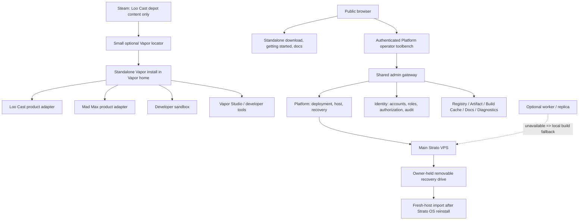

# Vapor Platform and Product Rebuild Charter

**Status:** Current owner-approved direction; implementation must follow the staged plan. This charter supersedes conflicting earlier target decisions, while historical observations remain historical.
**Date:** 2026-11-08
**Scope:** Cross-project boundaries and the Platform-owned operational/recovery layer. Product behavior remains in its owning repository.

## Mission

Make Vapor a standalone runtime and product ecosystem, not a Loo Cast Steam-app installation. Make the VPS and its web presence understandable, recoverable, and useful through task-focused interfaces. The owner must be able to rebuild the Platform from source and a local physical recovery set after replacing the VPS, while ordinary workflows stay simple and service-owned.

This is pre-alpha. Weak implementations may be replaced outright. The acceptable cost of a failed experiment is lost time, not stranded authority or irreplaceable data. Preserve useful historical evidence, but do not retain compatibility paths merely because they exist.

## Target shape

### Standalone runtime and product boundary

- Vapor is installed, updated, and uninstalled independently of Steam. Its managed binaries, source checkouts, toolchains, caches, settings, and state live under Vapor-owned user/system locations, not in a Steam app directory.
- The Loo Cast Steam app root is limited to `App.vapor.toml` and one final
  Packagepack artifact. That artifact represents the three first-party local
  products: Spacetime Engine, Loo Cast game, and Loo Cast Packagepack. Do not
  add a third loose root item. If Steam needs a direct “Vapor tools” launch
  option, resolve it inside the package/manifest launch contract or through
  Steam metadata, without bundling the Vapor runtime. The locator may only
  find/forward to a separately installed Vapor and must show clear install
  guidance when Vapor is absent; it never installs Vapor implicitly. Steam
  content must not carry developer toolchains, build caches, or Vapor user
  state.
- The three first-party Loo Cast products are depot-provided/local-only and cannot be made community-publishable by editing `App.vapor.toml` or another client manifest. The owning server policy is authoritative.
- Mad Max remains a separately acquired local game. Vapor detects and mounts the user's installation, maintains derived/cache data under Vapor-owned paths, and installs the MadMaxModding adapter/packagepack reversibly. No proprietary game bytes are uploaded or redistributed.
- A clean-room uninstall is an explicit, inspectable operation that inventories
  Vapor-owned current and historical paths, Steam integration, registrations,
  tasks, source checkouts, caches, and unsaved data. It is not the default
  uninstall. Its preview enumerates every selected path; unknown/unclassified
  paths are preserved. A separate full-purge choice may delete inventoried
  Vapor-owned unsaved data only after export offer and exact destructive
  confirmation. It must never delete original Mad Max files or arbitrary user
  data.

### Server and web presence

- One physical VPS may run multiple independent service processes behind one public domain and a shared authenticated admin gateway. The Platform repo owns composition, fixed host operations, deployment orchestration, backup/import/recovery, and the shared shell. Each service repo owns its business rules, records, policy, and service-specific interface fragment.
- The web dashboard is the normal graphical interface into these services; “service-owned authority” does not mean the owner must use the CLI. The gateway may present and invoke workflows, but never shadows owner records or bypasses their authorization/audit.
- Public pages serve Vapor downloads, clear product-aware getting-started flows, and working documentation. Admin tools are separate from public user flows. A narrowly scoped one-host emergency browser terminal is now in scope in a separate high-security dashboard area; it is not a general remote-shell product and remains disabled until its security prerequisites are met.
- Product workbenches are specialized views for Mad Max, native Loo Cast, and an isolated developer Sandbox. Shared UI primitives are encouraged; product licenses, local source detection, and content policy remain separate.
- The emergency browser terminal is equivalent to root SSH on the one Platform VPS. It requires root Identity authorization, a separate explicit short-lived session grant, a single connection, expiry and revocation, and lifecycle audit without transcript storage. This does not replace Strato VNC or owner SSH. The current shared public/admin origin remains a blocker: a same-origin script-injection flaw can issue requests as the root operator. Keep the host switch off until the admin origin/session boundary is isolated or Identity provides a verifiable step-up signal. Other privileged work remains bounded, named, and audited; do not turn this into arbitrary multi-host SSH, port forwarding, file transfer, or an always-on shell.

### Authority and identity

- Identity owns accounts, sessions, linked providers, roles, permission requests, grants, and audit. Platform owns deploy requests and temporary host access operations. The dashboard is the front door, not a second database.
- Steam, GitHub, Strato, and Vapor each retain distinct trust boundaries. Provider integration status must be visible and revocation/relinking explicit.
- Current owner preference is Steam-required sign-in because Valve is the
  preferred identity authority. Earlier the owner also selected Vapor-native
  accounts with optional providers; treat Steam-required as the current
  direction, but hold account migration until the owner confirms the final
  model and the migration is designed. Provider linking must not silently
  create duplicate Vapor identities.
- SSH access is requested by the machine/requester, with a public key generated and retained locally; the platform stores only the public key/fingerprint and bounded grant metadata. Submission authorization and actual host grant are distinct decisions. Do not display or transmit private keys. The narrow one-host emergency browser console described above is the explicit root-terminal exception; it is not generic SSH access and must remain disabled until its security gate is satisfied.

### Recovery and worker model

- The Strato account and OS-reinstall control are the outer recovery boundary.
  For full host compromise or uncertain integrity, perform an explicit Strato
  OS reinstall (manual Strato control panel if no safe provider API exists),
  then run the pinned fresh-host recovery kit. A Platform *state reset* is a
  different named operation; it must not pretend to reinstall the OS or erase
  the host. Both paths inventory and export first. Full-host recovery requires
  reauthorizing the owner's SSH key through the Strato boundary.
- Frequent primary-host exports and the owner-held unencrypted 128 GB USB
  backup are the baseline. The backup is plaintext because the owner chose
  physical custody and portability; access to the USB is equivalent to access
  to all included service secrets. Owner SSH private keys are never included in
  VPS exports or recovery archives; the owner reauthorizes them through Strato
  after reinstall. Keep USB custody controlled and add another copy when
  practical.
- Export checksums detect corruption but not malicious replacement by a compromised VPS. A clean-host recovery drill is the evidence that matters. It must prove restore of services/configuration/data and record what remains external (DNS, Strato account, provider login, Steam/GitHub authorization).
- A second low-cost node is optional and may provide builds, staging, or redundant backup. It is never required to deploy: local builds remain a supported fallback. Do not assume Docker, nested virtualization, or specific billing before measuring the chosen node.
- Current main VPS is resource constrained; concurrent native Windows/Linux building there is not assumed. Build worker topology remains a separate measured design.

## Ownership matrix

| Concern | Owner | Explicitly not owned here |
| --- | --- | --- |
| Host provisioning, Caddy/systemd, whole-system export/import, fixed operations, deployment lifecycle | Platform Server | Identity/catalog/product business rules |
| Accounts, login, linked providers, roles, grants, access policy, identity audit | Identity Server | Deployment queue or host filesystem |
| Catalog, publication eligibility, source bindings | Registry Server | Steam app content or client-side publication claims |
| Signed Vapor application releases | Artifact Server | Loo Cast/Mad Max game assets |
| Toolchain snapshot cache | Build Cache Server | Artifact releases or generic user files |
| Public homepage/docs service data and rendering | Homepage/Docs service repos | Platform composition and deployment policy |
| Standalone install/update, local paths, product adapters, workbenches | Vapor Client and product adapter repos | VPS identity or host deploy authority |
| Mad Max game integration | MM-Building-System | Vapor generic installer/update lifecycle |
| Native Loo Cast engine/game/packagepack source and depot packaging | Loo Cast repo | Vapor runtime or user's generic home |

## Explicit exclusions

- Do not distribute proprietary Loo Cast or Mad Max data through public Artifact, Registry, Build Cache, or diagnostics.
- Do not use the editable client manifest as entitlement/publish authority.
- Do not let one server/service own every workflow or move service business logic into the Platform root.
- Do not perform the production host wipe until a fresh-host restore drill and an owner-reviewed exact deletion inventory exist.
- Do not indiscriminately clean dirty checkouts, Ghidra databases, source caches, or game directories. Provide a reviewed clean-room operation and classify each path first.
- Do not turn the one-host emergency console into a general shell service, enable it by default, or distribute a permanent general-purpose SSH key. Browser root access stays an explicit, time-bounded emergency capability with its own security gate.

## Open decisions that block only their dependent work

1. Vapor login policy: Steam-required is the current preference, but confirm
   against the earlier Vapor-native-account choice before changing account
   identity. Provider-status UI can improve without changing identity.
2. Exact mechanism for Steam's optional Vapor tools launch action. The root
   contents are not open-ended: only `App.vapor.toml` and the final
   Packagepack artifact are allowed.
3. Which Windows locations are Vapor-owned historical paths and which user-created checkouts are valuable work. Generate a dry-run inventory and allow review before clean-room deletion.
4. Second node provider/OS/capacity/cost and whether it is a builder, backup replica, or both. Keep local fallback until measured.

## Acceptance evidence

- A clean Windows and Linux install starts Vapor without the Loo Cast app
  installed. Steam's optional launch action locates Vapor without owning its
  runtime, and reports installation guidance when Vapor is absent.
- Steam depot contains only the agreed Loo Cast content artifact/manifest/locator and no Vapor-managed runtime, toolchains, state, or caches.
- Vapor uninstall and full clean-room purge report exact paths and have separately tested preserve/export and delete modes.
- Public download/getting-started/docs links work; Platform admin pages are task-oriented, compact, accessible, and have real unavailable/failed/partial states.
- A browser cannot obtain arbitrary shell access. Privileged operations are typed, owner-gated, audited, and attributable.
- The emergency console stays inaccessible unless its host gate is explicitly enabled, root authorization succeeds, and the separate session grant is active. A clean security review records the admin-origin/step-up prerequisite before anyone enables it.
- Recovery on a disposable fresh Ubuntu host verifies service-owned state,
  Caddy routes, login/auth flows, exact source/submodule pins, and a repeat
  export. The drill must not use the production host. External provider
  prerequisites and owner SSH reauthorization are documented.
- Service deploy remains independently testable; full-system export/import composes pinned service revisions.
- Worker absence does not prevent a locally built release/deployment.
